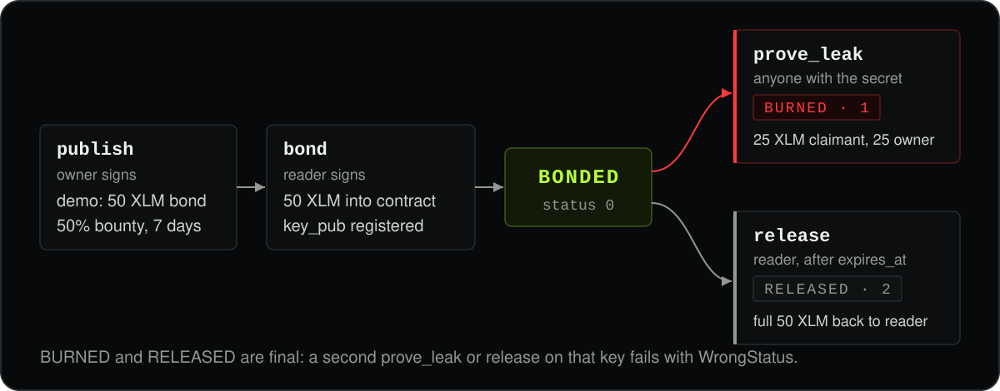
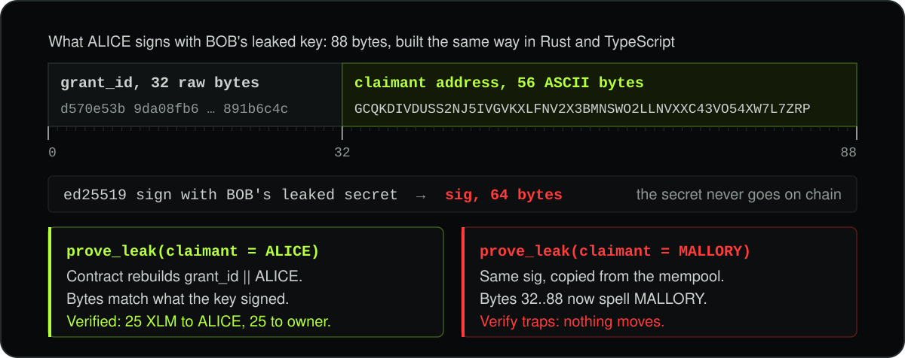

<p align="center">
  
</p>

POISONKEY is an access-control primitive on **Stellar + Soroban**. You bond value behind an access
credential, and the credential that grants your access is also the cryptographic evidence that
slashes your bond if it leaks. Nobody can stop you copying the key. If it gets out, though, you
lose your bond, and in the demo grant whoever found it walks away with 25 of your 50 XLM.

Built at **Build On Stellar Build Station, Mumbai**. The contract's live on Stellar Testnet:
[`CCJU4K6V…P4V3` on stellar.expert](https://stellar.expert/explorer/testnet/contract/CCJU4K6VPLUNLRSBEBMF73F7Q6VWIV74WGWDUBJKSYSOTJN3LCDOP4V3).

[How a leak is slashed](#how-a-leak-is-slashed) · [The 88-byte proof](#the-88-byte-proof) ·
[Run it](#run-it) · [Demo script](#demo-script) · [What it does not stop](#what-it-does-not-stop)

## How a leak is slashed

<p align="center">
  
</p>

The owner publishes a grant. You post the bond and register an Ed25519 public key, and the page
shows you the secret half once: it's the only key that decrypts the document. Keep it to yourself
until `expires_at` and you can call `release` to get all 50 XLM back. Let it slip, and anyone
holding it can sign a claim and take the bounty.

| Call | Signed by | What happens |
| --- | --- | --- |
| `publish` | owner | Stores the grant: token, `bond_amount`, `bounty_bps`, `expires_at`, `cipher_ref`. No value moves. |
| `bond` | reader | Moves `bond_amount` into the contract and registers the reader's `key_pub`. Status `BONDED` (0). |
| `prove_leak` | claimant | Checks a signature made with the leaked key, pays `bond_amount × bounty_bps / 10000` to the claimant and the remainder to the owner, in the same call. Status `BURNED` (1). |
| `release` | reader, after `expires_at` | Returns the full bond. Status `RELEASED` (2). |

There's no "approve punishment" button and no admin deciding who gets slashed. The rule's in
`contracts/poisonkey/src/lib.rs`, so you can read it before you bond. Each call also emits a
contract event (`published`, `bonded`, `leak`, `silent`), and the app's forensic ledger is built
from those events.

## The 88-byte proof

<p align="center">
  
</p>

As a reporter you never post the leaked secret on chain. You sign a message with it, and the
contract checks your signature against the public key the reader registered. `prove_leak` verifies
an Ed25519 signature over exactly 88 bytes, and the Rust and TypeScript sides have to agree on
every one of them:

```text
bytes  0..32   the raw 32-byte grant_id
bytes 32..88   the claimant's Stellar address as 56 ASCII bytes ("G...", strkey text,
               not the decoded key, no length prefix and no terminator)
```

Your own address sits inside those 88 bytes, so a signature someone spots in the mempool won't
pay them: swap in their address and the bytes no longer match what the key signed.
`contracts/poisonkey/src/test.rs` asserts this directly, and `scripts/e2e.mjs` checks it again
against the deployed contract.

## Why Stellar

If a platform held the deposits, judged leak claims and paid reporters, you'd have to trust it
twice: once as a reader and again as a reporter. Here the Soroban contract holds the bond,
verifies the proof and settles both payouts in one transaction. A 50 XLM bond with a 25 XLM
bounty only makes sense when each transaction is cheap, and on Stellar it is. The document itself
doesn't go on chain; Stellar holds the grant state and the money.

Stellar pieces in use: Soroban contracts, the `ed25519_verify` host function, the native XLM
Stellar Asset Contract, `require_auth` wallet authorization, contract events and Stellar Testnet.

## Live on Stellar Testnet

| | |
|---|---|
| Contract ID | `CCJU4K6VPLUNLRSBEBMF73F7Q6VWIV74WGWDUBJKSYSOTJN3LCDOP4V3` |
| Demo grant id | `d570e53b9da08fb6112b9ee94fa4503e5ff71e43da2fbcd961f399df891b6c4c` |
| Bond / bounty | 50 XLM / 50% (25 XLM to the reporter, 25 XLM to the owner) |
| Token | native XLM SAC, `CDLZFC3SYJYDZT7K67VZ75HPJVIEUVNIXF47ZG2FB2RMQQVU2HHGCYSC` |
| RPC | `https://soroban-testnet.stellar.org` |
| Explorer | [stellar.expert](https://stellar.expert/explorer/testnet/contract/CCJU4K6VPLUNLRSBEBMF73F7Q6VWIV74WGWDUBJKSYSOTJN3LCDOP4V3) |

The exact deployment's in `deploy/testnet.json`. `web/src/deployment.ts` is generated from it, so
the frontend can't drift from what's actually on chain.

The keypairs in that file are throwaway **testnet** identities holding no real value. They're
bundled on purpose: the page seeds its own demo board, so BOB and CARA are already bonded on screen
before you connect a wallet. Never put a mainnet secret there.

## Run it

**Contract tests.** 9 tests: the happy path, the payout split, a bad signature, a replayed
signature, a spent credential and release after expiry:

```bash
cargo test -p poisonkey
```

**Build the wasm** (you'll need `rustup target add wasm32v1-none` first):

```bash
cargo build -p poisonkey --target wasm32v1-none --release
```

**Deploy and provision.** Uploads the wasm, instantiates the contract, funds the demo identities
through Friendbot and writes `deploy/testnet.json`. It's safe to rerun; `--redeploy` forces a new
instance:

```bash
node scripts/deploy.mjs
```

**Regenerate the frontend config** from the deployment:

```bash
node scripts/write-config.mjs
```

**Check the whole mechanism against the deployed contract.** Publishes a throwaway grant, bonds
it, proves the leak, and asserts the payout split, the burn, the front-run rejection and the
double-spend rejection:

```bash
node scripts/e2e.mjs
```

**Run the frontend:**

```bash
npm install --prefix web && npm run dev --prefix web
```

**Between rehearsals.** A burned bond can't go back to BONDED, so point the demo at a fresh grant
and the page will re-seed a clean board:

```bash
node scripts/rotate-grant.mjs
```

## Demo script

1. The board's already live: BOB and CARA bonded at 50 XLM each, ledger sequence ticking.
2. Connect Freighter on Testnet and press **BOND & UNLOCK**. The document decrypts and your
   ACCESS CREDENTIAL appears. *This key opens the document, and it can also take your 50 XLM.*
3. Copy it and paste it into **LEAK HUNTER**. Before you sign anything, the panel names whose bond
   it is and the exact bounty.
4. Hand it to a friend. They connect *their own* Testnet wallet, paste the key and press
   **CLAIM BOUNTY**.
5. Your bond bar drains to zero, the pill flips to BURNED, 25 XLM lands in their wallet, and the
   forensic ledger gains a line with an explorer link.

Now try that same signature from a third wallet. It fails: your friend didn't publish the key,
they signed their own address with it.

## What it does not stop

POISONKEY **doesn't** make information impossible to copy. It can't stop screenshots, a phone
pointed at a screen, someone retyping what they read, or plaintext passed on by a reader who
decrypted it legitimately.

It's aimed at credentials where holding the key is the valuable part: an API key, an access token,
a paid capability, a temporary authorization. For those, a leak costs the person who leaked it.

## Where else it fits

POISONKEY is a primitive, and the document demo is one use of it. You could put the same bond
behind:

- **API credentials**: developers or contractors bond against temporary API access.
- **AI agent capabilities**: an agent gets a bonded credential for a tool, an API or a paid resource.
- **Paid datasets**: each consumer bonds against passing their key on.
- **Embargoed access**: reviewers get time-limited bonded credentials before a release date.
- **Privileged access**: temporary admin rights come with a bond.

Not built yet, but on the list: configurable bond policies, multiple assets, reputation from bonds that
ended in release, rotating credentials, organization-level grants, threshold or multi-party access,
encrypted resource delivery, automated revocation, analytics on burned credentials, and API gateway
integrations.

## Repository layout

```text
contracts/poisonkey/     the Soroban contract and its tests
scripts/                 deploy, seed, verify and rotate tooling (JS SDK, no CLI needed)
web/                     the single-page frontend (React + Vite + TypeScript)
deploy/testnet.json      what is deployed, and the demo identities
```

Contract: Rust, `soroban-sdk` 25.3.2. Frontend: React 19, Vite 7, TypeScript, `@stellar/stellar-sdk`
16, Freighter for wallets and `tweetnacl` for Ed25519 in the browser. The README images come from
`scripts/build_readme_assets.py`.

Contact: [@https-shubhamsahu](https://github.com/https-shubhamsahu) · shubhamsahu@nosus.foo
